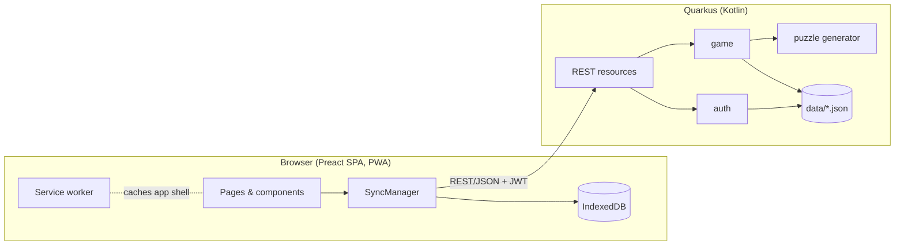
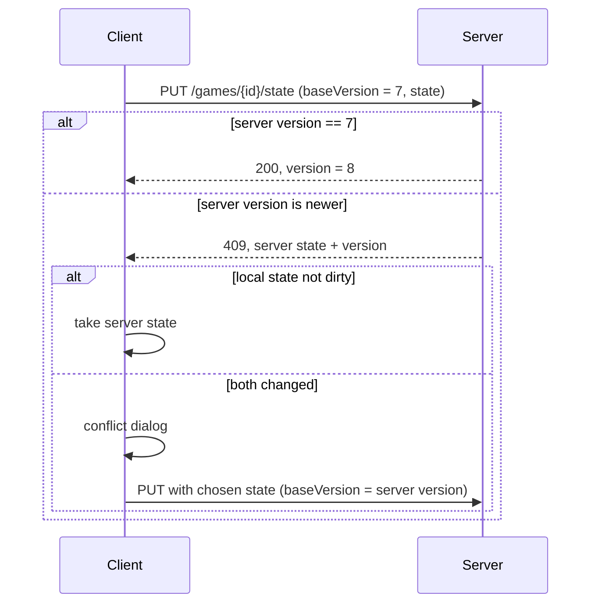

# Architecture – Mr Right

Browser-based elimination logic puzzle inspired by *Emma's Perfect Match*.
Background and all product decisions: [puzzle-analysis.md](puzzle-analysis.md).

## Overview



- One deployable Quarkus JAR; the built SPA is served from the same origin as static resources.
- The backend generates puzzles and is the source of truth for game state.
- The frontend keeps a local copy of every opened game, so playing works offline.

## Project Layout

Gradle monorepo, modelled on `avalons_final_stand`:

```
mr_right/
├── backend/      Kotlin + Quarkus
├── frontend/     Preact + TypeScript + Vite
├── e2e/          Playwright tests
└── doc/
```

- Package root: `com.tfassbender.mrright`
- HTTP port: `4720` (sibling projects use 4711–4719); Vite dev server: `5174` (proxies `/api` to 4720)
- Client-side routes (e.g. `/verify-email?token=…`) are rerouted to `index.html` by `rest/SpaRouting`
- Data directory: `data/` (gitignored, overridden in production)

## Backend

### Packages

Packaged by feature, no hexagonal layering. `storage` is plain infrastructure and never depends on a feature package:

| Package   | Content                                                                 |
|-----------|-------------------------------------------------------------------------|
| `puzzle`  | Suitor/attribute model, clues, `PuzzleConfig`, `PuzzleGenerator`, name catalog, seed handling |
| `game`    | `Game`, `GameState`, `GameService` (create, load, save state, delete), `GameRepository` |
| `auth`    | Registration, login, email verification, password reset, JWT, `UserRepository` – reused from `avalons_final_stand` |
| `storage` | `AtomicJsonFile` (crash-safe writes), `JsonMapper`, `DataDirectory` + `Clock` beans |
| `rest`    | Resources, DTOs, exception mapper, SPA routing                          |

Dependencies: `quarkus-rest-jackson`, `quarkus-kotlin`, `quarkus-arc`, `quarkus-smallrye-jwt(-build)`,
`quarkus-mailer`, `quarkus-cache`, `jackson-module-kotlin`, bcrypt.

### Puzzle Model

The book's six attributes, each suitor has exactly one value per attribute (see
[puzzle-analysis.md](puzzle-analysis.md#attributes-legend)):

```kotlin
enum class Income { AT_LEAST_1K, AT_LEAST_2K, AT_LEAST_4K, AT_LEAST_10K }   // £ .. ££££, ordinal
enum class Element { AIR, FIRE, WATER, EARTH }
enum class EyeColor { BROWN, BROWN_GREEN, AMBER, GREEN, BLUE }
enum class HairColor { BLOND, BROWN, BLACK, AUBURN }
enum class Temperament { BROODING, CHARMING, RESERVED, AMIABLE, DASHING }
enum class Interest { INTELLECTUAL, MUSICAL, SPORTY, SOCIABLE }

data class Suitor(
    val id: Int,                 // position in the directory, 0-based
    val firstName: String,
    val lastName: String,
    val income: Income,
    val element: Element,
    val eyeColor: EyeColor,
    val hairColor: HairColor,
    val temperament: Temperament,
    val interest: Interest,
)

data class PuzzleConfig(val suitorCount: Int, val finalistCount: Int)   // 100..10,000 and 1..5

data class Puzzle(
    val config: PuzzleConfig,
    val suitors: List<Suitor>,
    val clues: List<Clue>,         // always 12, in the book's order
    val finalistIds: Set<Int>,     // suitors matching all clues
    val solutionId: Int,           // Mr Right: the finalist with the fewest consonants
)
```

Name-derived properties (initials, vowel and consonant counts) are computed, not stored.
Vowels are a, e, i, o, u; y is a consonant. Names contain only the letters A–Z.

**Clues** are a sealed hierarchy. Each clue is a predicate on a suitor and is language-neutral –
the backend sends a type plus parameters, the frontend renders the text via i18n:

```kotlin
sealed interface Clue {
    fun matches(suitor: Suitor): Boolean
}

// attribute clues
data class IncomeAtLeast(val level: Income) : Clue                               // AT_LEAST_2K or AT_LEAST_4K
data class AttributeIsNot(val attribute: Attribute, val value: String) : Clue    // exactly one value
data class AttributeIsOneOf(val attribute: Attribute, val values: Set<String>) : Clue   // 2 or 3 values

// name clues
data object InitialsDiffer : Clue                                       // first name and surname initial differ
data class InitialsInRange(val range: LetterRange) : Clue               // both initials in A_TO_M or N_TO_Z
data object SurnameStartAndEndDiffer : Clue
data class FirstNameVowelCount(val count: Int) : Clue                   // exactly 2 or 3
data class SurnameVowelCount(val count: Int) : Clue                     // exactly 2 or 3
data class NameExcludesLetter(val letter: Char) : Clue                  // one of B, H, K, P, W

enum class Attribute { ELEMENT, EYE_COLOR, HAIR_COLOR, TEMPERAMENT, INTEREST }
```

`value`/`values` hold the enum constant names of the given attribute (e.g. `"BLOND"`); the implementation may
use typed values internally as long as the JSON stays the same.

JSON examples:
- `{ "type": "INCOME_AT_LEAST", "level": "AT_LEAST_4K" }` → en: "He earns at least £££ a year."
- `{ "type": "ATTRIBUTE_IS_ONE_OF", "attribute": "EYE_COLOR", "values": ["GREEN", "BLUE"] }`
- `{ "type": "NAME_EXCLUDES_LETTER", "letter": "H" }`

**Clue set** – always the book's 12 clues, one per "subject":

| Subject                              | Clue                                                   |
|--------------------------------------|--------------------------------------------------------|
| Income                               | `IncomeAtLeast`                                        |
| Element, eyes, hair, temperament, interest | one random attribute gets `AttributeIsNot`, the other four `AttributeIsOneOf` |
| Name (6)                             | each name clue type exactly once                       |

The order is fixed and follows the book's order of subjects, so attribute and name clues are mixed:
hair, income, initials differ, temperament, initials in range, interest, element, surname start/end,
first name vowels, eyes, excluded letter, surname vowels.

**Name catalog**: 120 first names × 120 surnames, a fixed list in the `puzzle` package. The order of the
lists is part of the generator (changing it changes all puzzles → new `generatorVersion`).

### Puzzle Generation

Deterministic: same seed + same config + same generator version → same puzzle.

- **Seed**: a free-text string (entered by the player or random). It is hashed (SHA-256, first 8 bytes)
  into a `Long` for `kotlin.random.Random`. Words like `"emma"` work as seeds.
- Seeds are 1–64 characters without leading/trailing spaces; a random seed is 10 lowercase letters/digits.
- **Config**: `suitorCount` (100–10,000) and `finalistCount` (1–5), validated against these limits.
  The clue count is fixed (12).
- **`GENERATOR_VERSION`**: a constant in the generator, stored with every game. It is increased whenever
  a change would produce a different puzzle for the same seed. No migration and no old generator versions
  are kept: a game with an outdated version is marked as outdated in the game list and can only be deleted.
- Only seed, config and generator version are stored; the puzzle is regenerated on demand and kept in an
  in-memory cache (`quarkus-cache`, keyed by seed + config).

**Algorithm** – constructive: decide the clues and the finalists first, then build everybody else around them,
so a valid puzzle comes out in a single pass (no searching for a random directory that happens to work):

1. **Clues**: pick the 12 clues with random parameters (see clue set above).
2. **Name groups**: evaluate the 6 name clues on all 14,400 catalog combinations and group them by the set of
   name clues they fail. Needed: a group failing *no* name clue (for finalists) and, per name clue, a group
   failing *only* that clue (for near misses). If one is empty or the finalists' tie-break below is impossible,
   re-roll the name clue parameters (step 1).
3. **Finalists**: create `finalistCount` suitors that match all clues – attributes drawn from the allowed values,
   names from the "fails nothing" group. Mr Right gets the name with the fewest consonants; the other finalists
   get names with strictly more consonants, so the tie-break is unique.
4. **Near misses** ("every clue counts"): for every clue create at least one suitor that fails *only* that clue
   (one disallowed attribute value, or a name from that clue's group). Dropping any clue therefore leaves more than
   `finalistCount` candidates.
   There are `1 + suitorCount / 2000` near misses per clue (1 for small directories, 6 for 10,000 suitors).
5. **Everybody else**: random name from the whole catalog + random attributes. Re-roll a suitor if it matches all
   clues or is identical (name + all attributes) to an existing suitor.
6. **Shuffle** all suitors and assign the ids (= directory position).
7. **Verify** (exactly the finalists match all clues, unique tie-break, every clue needed) – a failed check is a
   bug, not a retry case; tests cover it.

Because the clues are strong (roughly 1–3 % of random suitors pass all 12, see puzzle-analysis), step 5 rarely
re-rolls. In small directories most eliminations come from the planted near misses.

### Game Model

```kotlin
data class Game(
    val id: UUID,
    val ownerId: UserId,
    val seed: String,
    val config: PuzzleConfig,
    val generatorVersion: Int,     // GENERATOR_VERSION at creation time
    val createdAt: Instant,
    val state: GameState,
)

data class GameState(
    val crossedOut: Set<Int>,      // suitor ids marked as no match
    val possibleMatches: Set<Int>, // suitor ids starred as possible match – never also in crossedOut
    val finalistsFound: Boolean,   // finalists submitted correctly → tie-break revealed (stays true)
    val mrRightId: Int?,           // the correctly picked Mr Right, null until solved (solved = mrRightId != null)
    val wrongGuesses: Int,         // wrong finalist sets + wrong Mr Right picks
    val version: Long,             // incremented by the server on every save
    val updatedAt: Instant,        // client time of the last change, shown in conflict dialogs
)
```

- `mrRightId` instead of a plain `solved` flag: the server can re-check it, and the UI can show who was picked.
- Once `finalistsFound` is reached, the directory is locked (no more crossing out / restoring) – only the tie-break
  and the pick are left. On a correct submit the client crosses out everybody else and stars the finalists,
  so the server accepts `finalistsFound` only if every non-finalist is crossed out.
- `possibleMatches` defaults to empty, so game files saved before it existed still load.

Player aids (e.g. ticking off applied clues) will add fields to `GameState` later.

### Storage

File-based JSON, the same approach as `avalons_final_stand`:

```
data/
├── users.json                  (or users/<id>.json, as in the reference project)
└── games/<gameId>.json         one file per game
```

- Writes go through `AtomicJsonFile` (temp file + atomic move).
- On startup the game files are scanned into an in-memory index `ownerId → gameIds`.
- A per-game lock serializes concurrent saves of the same game.

### Authentication

Reused from `avalons_final_stand`:

- Email + password (bcrypt), email verification, password reset via mailer.
- JWT (HS256) as bearer token. Dev/test mode with email disabled.
- An account is required to play.
- Token lifetime: **30 days** instead of 24 h, so offline sessions and device switches
  don't keep forcing a new login.

## REST API

All endpoints under `/api`, JSON, JWT required except auth/info/health.

| Method | Path                       | Purpose                                                  |
|--------|----------------------------|----------------------------------------------------------|
| POST   | `/auth/register`, `/auth/login`, … | Auth flows (as in the reference project)         |
| GET    | `/games`                   | List own games with a progress summary                   |
| POST   | `/games`                   | Create a game `{ suitorCount, finalistCount, seed? }`    |
| GET    | `/games/{id}`              | Puzzle (suitors, clues, `finalistCount`, hashes) + state |
| GET    | `/games/{id}/state`        | Only the state (cheap refresh on open / tab return)      |
| PUT    | `/games/{id}/state`        | Save state `{ baseVersion, state }` → new version or 409 |
| DELETE | `/games/{id}`              | Delete a game                                            |
| GET    | `/info`, `/health`         | Version info, health check                               |

- **Payload size**: a 10,000-suitor puzzle is roughly 1.5–2 MB of JSON; HTTP compression
  (`quarkus.http.enable-compression`) shrinks it to a small fraction. Optimize the format only if needed.
- **Error codes** (besides auth): `INVALID_GAME_CONFIG`, `INVALID_SEED`, `INVALID_GAME_STATE` (400),
  `GAME_NOT_FOUND` (404, also for other players' games), `GAME_OUTDATED` (410, load/save of an outdated game),
  `VERSION_CONFLICT` (409, body carries the current server `state`).
- **Solution check**: the puzzle contains two hashes instead of the ids, so both steps can be checked
  **offline** without showing the answer in the payload:
  - `finalistsHash = SHA-256(gameId + ":" + sorted finalist ids joined by ",")` – checked when the player
    submits: the starred suitors once exactly `finalistCount` are starred, otherwise the remaining ones once
    exactly `finalistCount` are left. On a match the tie-break is revealed; a mismatch shows a hint and
    counts as a wrong guess.
  - `solutionHash = SHA-256(gameId + ":" + solutionId)` – checked when the player picks Mr Right.
  - Both can be brute-forced; that's accepted (see puzzle-analysis, "Cheating is accepted").
  - The server re-checks `finalistsFound` and `solved` against the real puzzle when the state is saved.

## Frontend

### Stack

| Concern       | Choice                                       |
|---------------|----------------------------------------------|
| UI            | Preact + TypeScript, Vite                    |
| State         | Preact Signals                               |
| Routing       | `preact-iso`                                 |
| i18n          | Paraglide JS (`de`, `en`)                    |
| Local storage | IndexedDB via `idb-keyval`                   |
| Offline       | `vite-plugin-pwa` (app shell cache, installable) |
| Long lists    | Virtualized list (only visible rows are rendered) |
| Tests         | Vitest (unit), Playwright (e2e)              |

### Pages

- **Login / Register / Verify / Reset**
- **Game list**: own games with progress (crossed out / total, solved, wrong guesses), "New game" button
- **New game**: suitor count, finalist count; under "Advanced options" the name and the seed (with a
  "random" button). The name defaults to "Mr Right - <date>" (date in the player's language), with " (2)",
  " (3)" … if the player already has a game with that name – computed in the frontend from the game list.
  Games created before names existed have none and are listed with the default name of their creation date.
  The game list doesn't show the seed
- **Game view**:
  - Directory: virtualized list, split into numbered sections of 100 suitors (section = `id / 100`);
    only the rows in view are rendered. Tap a row to cross out / restore, the star at its right marks a
    possible match. "Next open" in the app header (only the ↓ icon plus tooltip on phones) and opening the game scroll to the first suitor without any marker,
    keeping 1 (phone) to 3 (big screen) rows above it in view for orientation
  - Clue panel (12 clues + "N finalists"): bottom sheet on mobile, side panel on wide screens
  - "Check" (enabled once `finalistCount` suitors are starred or left) + confirmation: when `finalistsHash`
    matches, reveal the tie-break
    (fewest consonants in the full name, y counts as a consonant)
  - "This is Mr Right" action on a finalist → confirmation dialog → result (wrong guesses are counted, no losing)
  - Offline indicator: note icon with "changes are only stored on this device"
- **Settings**: language

### Modules

```
src/
├── api/          REST client, DTO types
├── storage/      IndexedDB access
├── sync/         SyncManager (autosave, offline queue, conflicts)
├── i18n/         Paraglide messages (messages/de.json, messages/en.json)
├── components/   UI building blocks
└── pages/        Routed pages
```

## Saving & Sync

### Autosave

- Every change updates the local state in IndexedDB **immediately** and marks it `dirty`.
- The server save is **debounced**: 3 s after the last change, at the latest every 30 s while playing.
- Extra flush when the tab is hidden/closed (`visibilitychange`, `fetch` with `keepalive`).
- On opening a game or returning to the tab, the client fetches the server state to pick up changes
  from another device.

### Local Storage (IndexedDB)

Keys are namespaced by user id (`<userId>:…`), so accounts on a shared device stay apart:

| Key                  | Content                                                            |
|----------------------|--------------------------------------------------------------------|
| `<userId>:game:<id>` | The puzzle (`GameDto`), stored once when the game is first opened  |
| `<userId>:state:<id>`| `{ state, baseVersion, dirty }` – written on every change          |
| `<userId>:list`      | The last game list from the server, shown when offline             |

A game opens from IndexedDB if it's there (works offline) and then refreshes from `GET /games/{id}/state`.
The game list shows a game's local progress when it is `dirty` (not saved yet) or when offline.
The SyncManager's status is `synced`, `pending`, `offline` (network error, retried every 30 s and on `online`)
or `error` (rejected by the server, e.g. deleted – not retried).

### Conflict Detection

Optimistic locking with the server-side `version`:



The **conflict dialog** shows both versions with a summary and the player chooses:
number of crossed-out names, solved yes/no, wrong guesses, time of the last change (`updatedAt`).

### Offline

- Opened games (puzzle + state) live in IndexedDB; the service worker caches the app shell.
- Requests that fail because of a missing connection keep the state `dirty`; the note icon is shown.
- On the `online` event (and periodically) the SyncManager retries; conflicts follow the flow above.
- Creating new games requires a connection.

## Sharing (later, optional)

Kept out of the first version. Planned rules:

- A game gets a list of invited players; all play on the same state.
- The owner always wins conflicts.
- While the owner is playing (heartbeat-based lease, e.g. renewed every 30 s), others can't play that game.

The `Game` model can get a `sharedWith: List<UserId>` field without changing the rest.

## Testing

- **Backend**: JUnit5 – generator properties (deterministic, exactly the finalists match, unique tie-break,
  every clue needed, across many seeds and configs) and
  game service; RestAssured for the REST API (`@QuarkusTest`, test data dir under `build/`).
- **Architecture** (ArchUnit, `ArchitectureTest`): only two rules – no dependency cycles between packages,
  and `puzzle` must not depend on Quarkus/Jakarta/Vert.x.
- **Frontend**: Vitest for SyncManager and conflict logic.
- **E2E**: Playwright, desktop and mobile viewport.

## Open Points

- Player aids, look & feel, name lists, clue flavour texts, sharing details (postponed).
