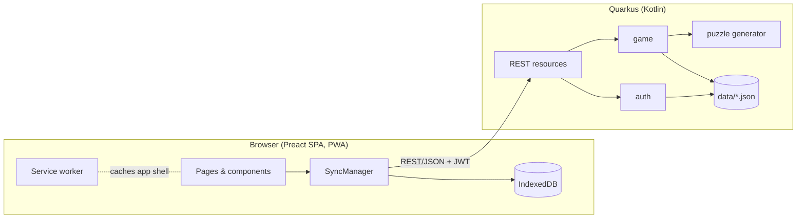
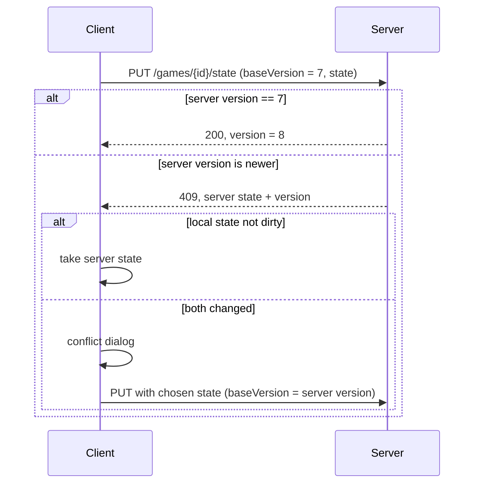

# Architecture – Mr Right

Browser-based elimination logic puzzle inspired by *Emma's Perfect Match*.
Background and all product decisions: [puzzle-analysis.md](puzzle-analysis.md).

Items marked *(assumption)* are proposals that still need confirmation.

## Overview



- One deployable Quarkus JAR; the built SPA is served from the same origin as static resources.
- The backend generates puzzles and is the source of truth for game state.
- The frontend keeps a local copy of every opened game, so playing works offline.

## Project Layout

Gradle monorepo, modelled on `avalons_final_stand`:

```
mr_right/
├── backend/      Kotlin + Quarkus
├── frontend/     Preact + TypeScript + Vite
├── e2e/          Playwright tests
└── doc/
```

- Package root: `com.tfassbender.mrright`
- HTTP port: `4720` (sibling projects use 4711–4719); Vite dev server: `5174` (proxies `/api` to 4720)
- Client-side routes (e.g. `/verify-email?token=…`) are rerouted to `index.html` by `rest/SpaRouting`
- Data directory: `data/` (gitignored, overridden in production)

## Backend

### Packages

Packaged by feature, no hexagonal layering. `storage` is plain infrastructure and never depends on a feature package:

| Package   | Content                                                                 |
|-----------|-------------------------------------------------------------------------|
| `puzzle`  | Suitor/attribute model, clues, `PuzzleConfig`, `PuzzleGenerator`, name catalog, seed handling |
| `game`    | `Game`, `GameState`, `GameService` (create, load, save state, delete), `GameRepository` |
| `auth`    | Registration, login, email verification, password reset, JWT, `UserRepository` – reused from `avalons_final_stand` |
| `storage` | `AtomicJsonFile` (crash-safe writes), `JsonMapper`, `DataDirectory` + `Clock` beans |
| `rest`    | Resources, DTOs, exception mapper, SPA routing                          |

Dependencies: `quarkus-rest-jackson`, `quarkus-kotlin`, `quarkus-arc`, `quarkus-smallrye-jwt(-build)`,
`quarkus-mailer`, `quarkus-cache`, `jackson-module-kotlin`, bcrypt.

### Puzzle Model

The real attribute list from the book is still unknown, so the model is built to be extended.

```kotlin
data class Suitor(
    val id: Int,                 // position in the directory, 0-based
    val firstName: String,
    val lastName: String,
    val eyeColor: EyeColor,
    val hairColor: HairColor,
    val fortune: Int,            // 1..4 (£ .. ££££)
    val zodiac: ZodiacSign,      // element derived from the sign
)

data class PuzzleConfig(val suitorCount: Int, val clueCount: Int)

data class Puzzle(val config: PuzzleConfig, val suitors: List<Suitor>, val clues: List<Clue>, val solutionId: Int)
```

Name-derived properties (vowel count, initial, name length) are computed, not stored.

**Clues** are a sealed hierarchy. Each clue is a predicate on a suitor and is language-neutral –
the backend sends a type plus parameters, the frontend renders the text via i18n:

```kotlin
sealed interface Clue {
    fun matches(suitor: Suitor): Boolean
}
data class EyeColorIs(val color: EyeColor) : Clue
data class EyeColorIsNot(val color: EyeColor) : Clue
data class FortuneAtLeast(val level: Int) : Clue
data class FirstNameVowelCount(val count: Int) : Clue
data class ZodiacElementIs(val element: ZodiacElement) : Clue
// … more once the book's clue types are known
```

JSON example: `{ "type": "FORTUNE_AT_LEAST", "level": 3 }` → en: "He has a fortune of at least £££."

### Puzzle Generation

Deterministic: same seed + same config → same puzzle.

- **Seed**: a free-text string (entered by the player or random). It is hashed (SHA-256, first 8 bytes)
  into a `Long` for `kotlin.random.Random`. Words like `"emma"` work as seeds.
- **Config**: `suitorCount` (e.g. 100–6,400) and `clueCount` (e.g. 3–12), validated against limits.
- Only seed and config are stored; the puzzle is regenerated on demand and kept in an in-memory
  cache (`quarkus-cache`, keyed by seed + config).

**Algorithm** – build the solution instead of searching for one *(assumption)*:

1. Generate the suitors with random names and attributes; pick the target.
2. Pick `clueCount` clues that are true for the target. Their combined pass rates should be about
   `1 / suitorCount`, so each clue removes a satisfying chunk of the directory.
3. **Uniqueness**: every other suitor matching all clues gets one attribute changed so that it fails
   exactly one random clue.
4. **Every clue counts**: for each clue, make sure at least one suitor fails *only* that clue
   (plant one if missing). Then dropping any clue leaves more than one candidate.
5. Verify (unique + minimal); on failure retry with the next value from the same random sequence.

This guarantees a valid puzzle in a single pass for every config, unlike random search.

### Game Model

```kotlin
data class Game(
    val id: UUID,
    val ownerId: UserId,
    val seed: String,
    val config: PuzzleConfig,
    val createdAt: Instant,
    val state: GameState,
)

data class GameState(
    val crossedOut: Set<Int>,      // suitor ids
    val solved: Boolean,
    val wrongGuesses: Int,
    val version: Long,             // incremented by the server on every save
    val updatedAt: Instant,        // client time of the last change, shown in conflict dialogs
)
```

Player aids (e.g. ticking off applied clues) will add fields to `GameState` later.

### Storage

File-based JSON, the same approach as `avalons_final_stand`:

```
data/
├── users.json                  (or users/<id>.json, as in the reference project)
└── games/<gameId>.json         one file per game
```

- Writes go through `AtomicJsonFile` (temp file + atomic move).
- On startup the game files are scanned into an in-memory index `ownerId → gameIds`.
- A per-game lock serializes concurrent saves of the same game.

### Authentication

Reused from `avalons_final_stand`:

- Email + password (bcrypt), email verification, password reset via mailer.
- JWT (HS256) as bearer token. Dev/test mode with email disabled.
- An account is required to play.
- Token lifetime: **30 days** instead of 24 h *(assumption)*, so offline sessions and device switches
  don't keep forcing a new login.

## REST API

All endpoints under `/api`, JSON, JWT required except auth/info/health.

| Method | Path                       | Purpose                                                  |
|--------|----------------------------|----------------------------------------------------------|
| POST   | `/auth/register`, `/auth/login`, … | Auth flows (as in the reference project)         |
| GET    | `/games`                   | List own games with a progress summary                   |
| POST   | `/games`                   | Create a game `{ suitorCount, clueCount, seed? }`        |
| GET    | `/games/{id}`              | Puzzle (suitors, clues, `solutionHash`) + state          |
| PUT    | `/games/{id}/state`        | Save state `{ baseVersion, state }` → new version or 409 |
| DELETE | `/games/{id}`              | Delete a game                                            |
| GET    | `/info`, `/health`         | Version info, health check                               |

- **Payload size**: a 6,400-suitor puzzle is a few hundred KB of JSON; HTTP compression
  (`quarkus.http.enable-compression`) brings it well below 100 KB. Optimize the format only if needed.
- **Solution check**: the puzzle contains `solutionHash = SHA-256(gameId + solutionId)` instead of the
  solution id, so a guess can be checked **offline** without revealing the answer in the payload.
  The server re-checks `solved` against the real solution when the state is saved.

## Frontend

### Stack

| Concern       | Choice                                       |
|---------------|----------------------------------------------|
| UI            | Preact + TypeScript, Vite                    |
| State         | Preact Signals                               |
| Routing       | `preact-iso`                                 |
| i18n          | Paraglide JS (`de`, `en`)                    |
| Local storage | IndexedDB via `idb-keyval`                   |
| Offline       | `vite-plugin-pwa` (app shell cache, installable) |
| Long lists    | Virtualized list (only visible rows are rendered) |
| Tests         | Vitest (unit), Playwright (e2e)              |

### Pages

- **Login / Register / Verify / Reset**
- **Game list**: own games with progress (crossed out / total, solved, wrong guesses), "New game" button
- **New game**: suitor count, clue count, optional seed
- **Game view**:
  - Directory: virtualized list with section headers; tap a row to cross out / restore
  - Clue panel: bottom sheet on mobile, side panel on wide screens
  - "This is Mr Right" action on a row → confirmation dialog → result (wrong guesses are counted, no losing)
  - Offline indicator: note icon with "changes are only stored on this device"
- **Settings**: language

### Modules

```
src/
├── api/          REST client, DTO types
├── storage/      IndexedDB access
├── sync/         SyncManager (autosave, offline queue, conflicts)
├── i18n/         Paraglide messages (messages/de.json, messages/en.json)
├── components/   UI building blocks
└── pages/        Routed pages
```

## Saving & Sync

### Autosave

- Every change updates the local state in IndexedDB **immediately** and marks it `dirty`.
- The server save is **debounced**: 3 s after the last change, at the latest every 30 s while playing.
- Extra flush when the tab is hidden/closed (`visibilitychange`, `fetch` with `keepalive`).
- On opening a game or returning to the tab, the client fetches the server state to pick up changes
  from another device.

### Conflict Detection

Optimistic locking with the server-side `version`:



The **conflict dialog** shows both versions with a summary and the player chooses:
number of crossed-out names, solved yes/no, wrong guesses, time of the last change (`updatedAt`).

### Offline

- Opened games (puzzle + state) live in IndexedDB; the service worker caches the app shell.
- Requests that fail because of a missing connection keep the state `dirty`; the note icon is shown.
- On the `online` event (and periodically) the SyncManager retries; conflicts follow the flow above.
- Creating new games requires a connection.

## Sharing (later, optional)

Kept out of the first version. Planned rules:

- A game gets a list of invited players; all play on the same state.
- The owner always wins conflicts.
- While the owner is playing (heartbeat-based lease, e.g. renewed every 30 s), others can't play that game.

The `Game` model can get a `sharedWith: List<UserId>` field without changing the rest.

## Testing

- **Backend**: JUnit5 – generator properties (deterministic, unique solution, every clue needed) and
  game service; RestAssured for the REST API (`@QuarkusTest`, test data dir under `build/`).
- **Architecture** (ArchUnit, `ArchitectureTest`): only two rules – no dependency cycles between packages,
  and `puzzle` must not depend on Quarkus/Jakarta/Vert.x.
- **Frontend**: Vitest for SyncManager and conflict logic.
- **E2E**: Playwright, desktop and mobile viewport.

## Open Points

- Rules, attribute list and clue types from the book (photos pending) → extend the puzzle model.
- Player aids, look & feel, name lists, sharing details (postponed).
- Confirm assumptions: constructive generation, offline solution check via hash, 30-day token lifetime.
